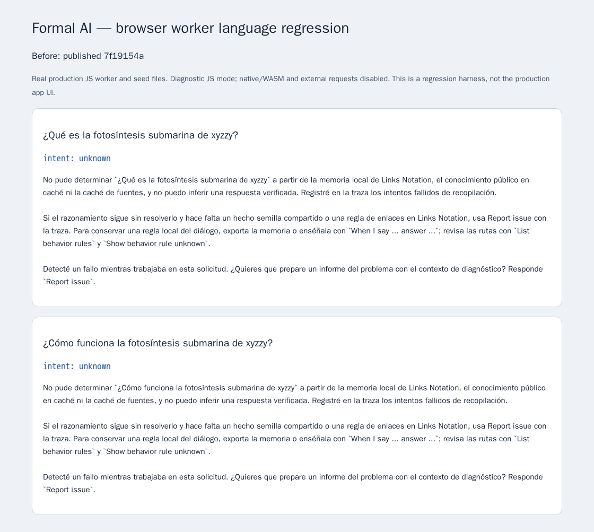
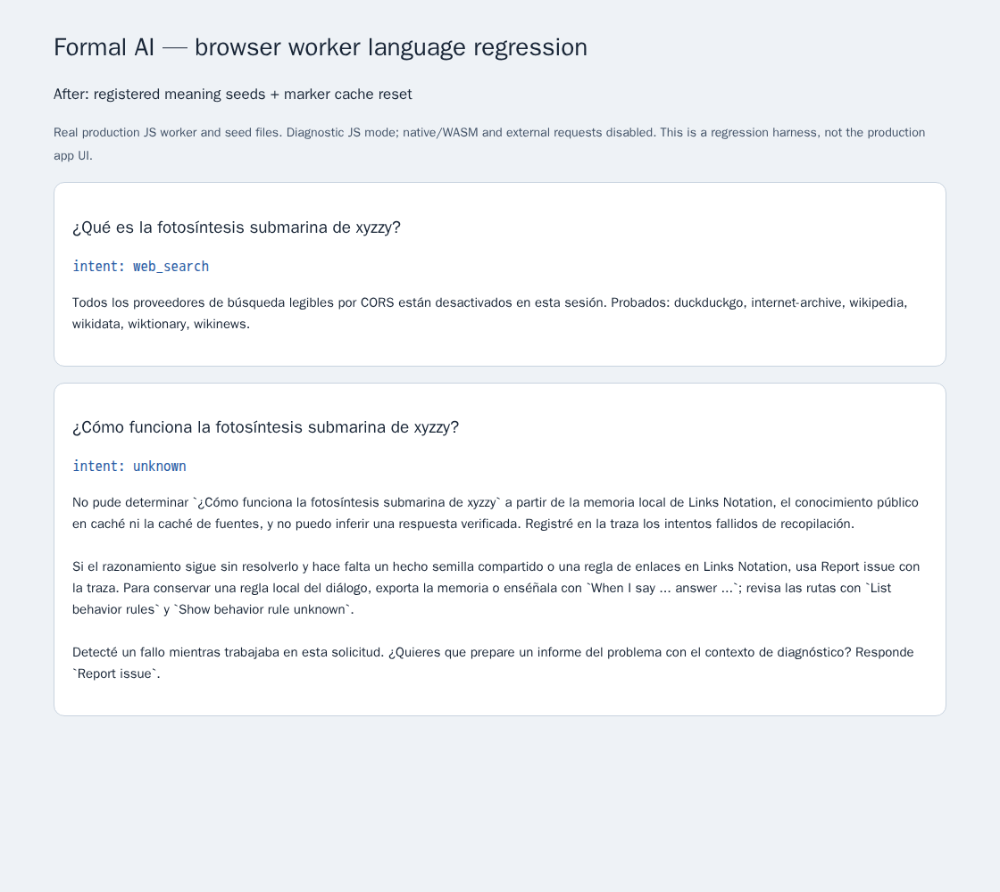

# Browser meaning hydration and native unresolved-language source binding

PR: https://github.com/link-assistant/formal-ai/pull/1581

The published input `7f19154a21d79f268f48af6b0938f17e6fb32ba3` completes **23/23 workflows successfully**. The actual native job is https://github.com/link-assistant/formal-ai/actions/runs/44320550638/job/134858261266. Its retained raw log has SHA-256 `9e5ee69e03209a27cd3db0f6fe34e0e04af78ce4edfc15459e7b6ea2a9269487`; selected lines 1630–1672 show calendar/currency 1/1, executor 8/8, forced functions 1/1 and synthesis 12/12. The full 1,855-line payload is retained, without a full literal-read claim. This is earlier published verification; the language changes below still need their own hosted execution.

## Browser root cause and regression

The generated `FORMAL_AI_CRATE_MEANING_SEEDS` registry includes `learned-request-openers` and `software-project-phrases`. Their text was fetched but the meaning hydrator accepted only `meanings.lino` and `meanings-*.lino`. It omitted the registered files, including the Spanish definition and Google Trends request frames. It also retained a warmed `WEB_SEARCH_MARKERS_CACHE` after replacing seed text.

The hydrator now accepts the exact registered `.lino` basenames as well as the existing extension-fixture convention, and invalidates the derived marker cache. No production prompt or language-specific phrase is added to JavaScript. Tests reject an unregistered basename and a wrong extension, replace warmed markers, and replay **both unchanged prompts** from the authored native Spanish sibling contract. The full native Spanish “how” answer remains an exact equality assertion.

With fixture text corrected to the existing space normalization, the unchanged production worker fails three of ten focused tests: the registered Spanish request, registered synthetic frame and warmed-marker replacement. After the production fix, **10/10 pass**. The earlier first attempt also had a hyphen normalization mistake in test expectations; its failing log is retained separately and does not establish an additional production defect.

Raw focused log hashes:

- Initial fixture draft: `65a7d0dcfdd103580ecce1c8dde2e2c856dc5069023efc21a144008e0fadae1e`.
- Valid pre-fix regression: `82b87ed021d42f7cb55b0642790125753fd98a0dd3d4e55407cf468b67bb844e`.
- Passing post-fix regression: `9a1184fb04e02a133cbe91c7e1be61d7919ab0d50de795b24705364e7f20c051`.

The four adjacent files pass (boot prefetch 1/1, transport 2/2, unresolved routing 5/5 and fixture integrity 2/2), as do the five selected worker/specification gates. A first foreground batch exceeded the Formal AI shell tool's own 60-second limit during the last gate. Its completed checks were preserved, and only the unfinished gate resumed in a background worker; all nine checks subsequently completed. No local native build runs.

## Real browser evidence

Run the bounded local server `python3 experiments/issue-1580/browser-meaning-server.py`, then the supplied `capture-meaning-hydration-browser.js` through Playwright MCP. The server substitutes only the exact published meaning hydrator on port 8048 and the working hydrator on 8049. Each server has a ten-minute deadline and 2,000-request limit. The harness sends both original Spanish prompts to the real production Worker with `jsfallback=1`. The Playwright context blocks external hosts; no native/WASM execution is claimed. The optional search-component bundle is absent, so its maintained unavailable-component fallback is used.

The generated production app UI bundles are absent from this checkout. These screenshots deliberately show a labeled regression harness, **not the production app UI**. Chromium reports `[unknown, unknown]` before and `[web_search, unknown]` after. The complete second answer is byte-equal between phases. Full browser observations, response evidence, screenshot hashes, bounded server logs and receipts are retained under `experiments/issue-1580/evidence/checks/browser-meaning-hydration/browser/`. The browser is closed and both server ports are confirmed closed.

Before:

After:

## Native source binding

The retained original main failure returned `concept_lookup` for `¿Cómo funciona la fotosíntesis submarina de xyzzy?` instead of the authored `unknown` response. `answer_unknown_prompt` tried retrieved senses before its unsupported-language fallback; the highest-tier retrieved word gloss could replace an entire unparsed sentence.

The narrow guard refuses retrieved glosses as answers to non-bare prompts in languages outside the declared answer set, retaining an `external_source:no_verified_answer` gather result. Existing supported-language definitions and unsupported-language bare terms remain eligible for attributed concept lookup. This does not claim generic answer binding for all supported-language questions, memory/cache matches or multi-passage reasoning.

Four tests use the real committed `issue-1138-b1/expected-senses.json` capture metadata. They check the exact original full Spanish answer against an unrelated retrieved word, a word actually mentioned in an unparsed question, an attributed English definition, and an attributed Spanish bare term. Hosted CI will execute these library tests and the **unchanged original** `a_language_without_localized_openers_reports_a_gap_not_english` contract as an isolated `any_language` target. The admission classifier includes both test inputs and their embedded fixture. JavaScript policy tests inspect the real workflow and source closure.

The first local static checks exposed formatting, the old exact workflow-command list and the governed Cargo fixture hash. All three were corrected with full logs retained. The reviewed witness refresh updates the four references to `rust/Cargo.toml` and asserts complete-object equality after only those hash replacements. All 1,185 records (221 supported, 964 unsupported), the authoritative native source manifest and every unsupported object are retained. The original reader is unchanged. A subsequent main integration and its complete witness delta require separate review before publication.

## Verification still required

The complete local gate run and fresh main integration are in progress. The gate correctly flagged test literals placed under `rust/src`; move the captured-source test module into the existing test tree instead of relaxing the specialization ceiling. Review every collected failure, merge the newly advanced default branch, rerun affected checks and the full shared-data gate inventory, and collect next-head hosted results before claiming native success.

Every broader issue criterion remains open in the work plan. Independent Formal AI reasoning acceptance remains **0/20**: all supplied patches, scripts, commands and review here receive zero independent authorship credit. PR #1581 remains draft and unmerged.

The first complete local inventory finishes in 764.618 seconds: 80 executable gates pass, six fail and 52 are explicitly excluded. All six failures trace to placing the new test-only module under `rust/src` (one abbreviation, two literal predicates, four natural-language strings and three test prompts); the tests have moved into the existing test tree without changing any ceiling or allowlist. All 91 aggregate/focused/detailed payload hashes are verified. No merged-tree or new native execution is claimed yet. Main advanced to `30ff2d8a8`; merge and complete revalidation are next.
