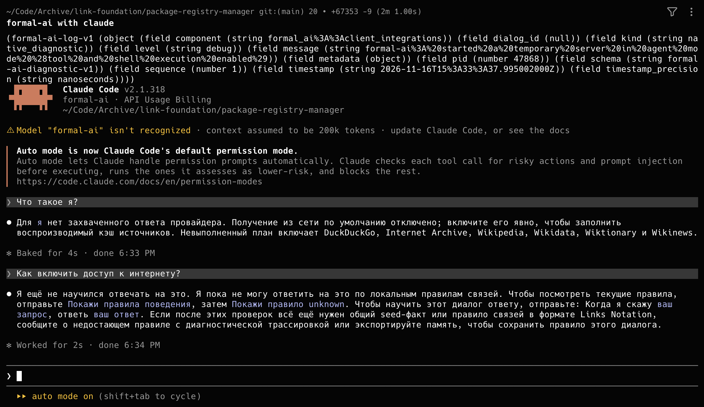
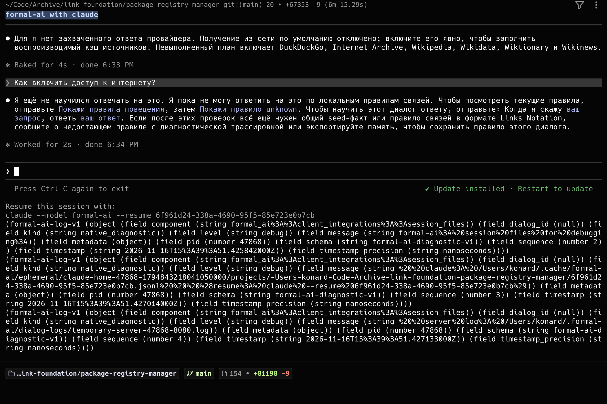
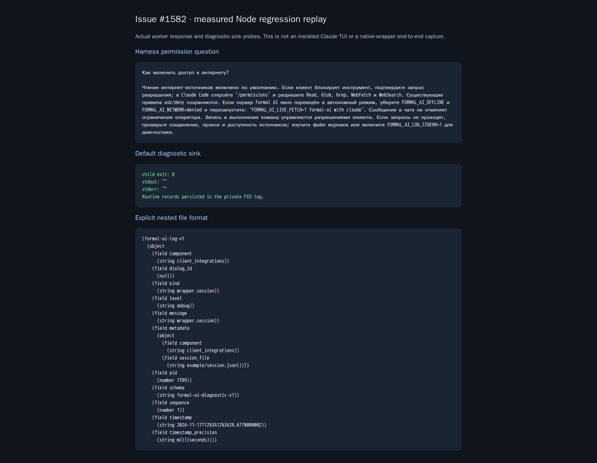

# Issue #1582: Claude wrapper access, diagnostics and context limits

Source: [issue #1582](https://github.com/link-assistant/formal-ai/issues/1582).
Implementation: [PR #1583](https://github.com/link-assistant/formal-ai/pull/1583).
This investigation includes the description edit of 2026-11-17 and all issue
comments, PR conversation comments, inline comments and reviews. The issue's
sub-issue endpoint returned no required sub-issues.

## Observations and timeline

| UTC | Evidence and interpretation |
| --- | --- |
| 2026-11-16 15:33:37.995002 | The first screenshot records wrapper startup at Formal AI 0.355.34, launching Claude Code 2.1.318. Routine startup diagnostics and typed machine records occupy the terminal. Claude warns that the unknown `formal-ai` model receives a 200,000-token fallback. |
| 2026-11-16 15:33–15:39 | The Russian conversation asks about “я” and then “Как включить доступ к интернету?”. The response says live retrieval is disabled by default; the follow-up is unrecognized. The screenshot is evidence of the displayed response, not a complete provider request trace. |
| 2026-11-16 15:39:51.425842 | The exit screenshot records session, resume and temporary-server paths printed into the harness. |
| 2026-11-16 16:06–16:09 | The earlier Hive Mind draft run could not verify serving identity. Its bot comment and uploaded artifacts report zero accepted authorship. The earlier PR discussion also reports unavailable attachment evidence and no implementation changes. |
| 2026-11-16 16:08:38 | Eleven workflows on head `b396646246aaeae920f245b1c5d3eff0f3909241` conclude `action_required`. These are approval-gated runs, not test failures. All 33 available historical branch runs have the same conclusion. |
| 2026-11-17 11:29:26 | The issue description adds repository evidence retention, a thorough case study, primary-source research and upstream reporting requirements. |
| 2026-11-17 | This repair downloads and inspects both screenshots, retrieves available run artifacts, reproduces the access/logging/routing regressions, and adds focused JavaScript and native wrapper regressions. See the archived execution logs and evidence inventory for exact attempts and results. |

Original screenshots:





After the repair, the following browser capture renders the actual Node worker
answer and diagnostic probe output. It is a regression replay, not an installed
Claude TUI or a native-wrapper end-to-end capture. Its measured input/output is
retained in `raw-data/local/render-evidence.json`.



## Evidence custody and limits

`raw-data/` retains the downloaded issue and PR snapshots, all three PR feedback
types, empty sub-issue results, branch workflow metadata, the earlier draft run
log, downloaded artifacts, research snapshots and each attempted CI log fetch.
Large text evidence is gzip compressed without changing its decoded bytes.
`evidence-index.json` records paths, byte counts and SHA-256 digests. Local
reproduction and verification transcripts are retained under `raw-data/local/`.
Commands and supplied repair recipes live in `experiments/issue_1582/`.

For every historical workflow, `raw-data/ci/<run-id>.log-status.json` preserves
the run's SHA, creation time, conclusion and retrieval error. GitHub returns
`failed to get run log: log not found`; the corresponding `.log.gz` decodes to zero bytes and
records that no job log was available. We do not reinterpret that as a passing
test or invent an underlying compiler error. `raw-data/ci/inventory.json`
enumerates every attempt.

The screenshots name two files on the reporter's Mac:

- `/Users/konard/.formal-ai/dialog-logs/temporary-server-47868-8080.log`
- `/Users/konard/.cache/formal-ai/ephemeral/claude-home-47868-1794843218041050000/projects/-Users-konard-Code-Archive-link-foundation-package-registry-manager/6f961d24-338a-4690-95f5-85e723e0b7cb.jsonl`

Those files were not attachments or workflow artifacts. This environment cannot
read that Mac. Their paths and visible contents are preserved in the original
images; their full contents remain unavailable. Likewise, the screenshots do
not provide the original shell environment, proxy configuration or complete
Claude settings. Conclusions below distinguish source-confirmed causes from
unverified environment-specific contributors.

## Root causes and implemented changes

| Symptom | Confirmed cause | Repair and verification |
| --- | --- | --- |
| Network retrieval disabled by default | Native dispatcher, capability, version-resolution, benchmark, live-search and synthesis paths and the Node source cache interpreted an absent `FORMAL_AI_LIVE_FETCH` as false. | Default-on read policy in `js/server/read-access.mjs` and its native twin; explicit live-fetch false, offline and network deny settings win. Native explicit URL fetches now honor the same deny policy. |
| Node server cannot reach providers even when enabled | `createWorkerContext` mapped every fetch URL to a local file. The server supplied no external transport. | The server supplies an HTTP(S) GET/HEAD transport; isolated worker fixtures keep their local-only default. A loopback HTTP regression checks a real GET and confirms POST and explicit denies never reach the source server. |
| Enabling internet is unrecognized | No dedicated semantic role or localized permission guidance existed. English procedural routing also preempted the new role. | Seed-defined intent and responses in English, Russian, Hindi, Chinese and Spanish; a narrow shared-role routing guard; native routing twin. Tests solve the actual questions, including the screenshot's Russian question. |
| Guidance claims retrieval is default-off | The web-search failure response encoded the previous opt-in policy as a universal explanation. | Localized messages now distinguish missing captures from connectivity, provider failure and explicit restrictions. They point to the permission help instead of promising a successful fetch. |
| Startup/exit and structured diagnostics flood the harness | Native diagnostic writes always targeted stderr, while file persistence was serve-only. The Node serving logger also always added stderr. | Both serving sinks persist routine diagnostics quietly by default. Native wrappers also get file logs. Explicit verbose/stderr configuration restores terminal diagnostics. Machine orchestration control records remain available to their protocol consumer. |
| Single-line records are hard to inspect | The diagnostic format had no nested presentation option. | Canonical single-line typed Lino remains default. `FORMAL_AI_LOG_FORMAT=nested` selects indentation; redaction runs first. Tests parse the resulting tree and confirm the typed value and redaction survive. |
| Claude assumes 200k | The wrapper names a custom model but did not supply Claude's documented context override. | Ephemeral environment and global profile now carry `CLAUDE_CODE_MAX_CONTEXT_TOKENS` and the served output limit. Read-only tools are preapproved without blanket permission bypass; global permissions append without replacing existing allow/deny rules. Native fake-client regressions verify the actual environment and configuration. |
| Other clients guess a context window | Several seed integrations lacked model metadata; Codex's catalog always used the launching machine's window even for a remote server. | Codex uses the same served-limit snapshot as other integrations. Existing OpenCode-shaped clients retain numeric limits. Qwen gets generation context settings, Aider gets model metadata, and current Grok gets a typed TOML model definition while retaining its older JSON global configuration. Gemini gets the documented output override; its input budget remains blocked upstream as described below. |

Codex/T3 Codex configuration also selects the dedicated `web_search = "live"`
tool. Upstream's read-only permission profile restricts command networking;
live search provides the read-only source path through Formal AI without
granting a shell unrestricted network access. The native adapter regression
checks the actual generated setting. Archived official source is pinned in
`raw-data/research/codex-source-sha.txt`.

T3 Code also launches Claude Code, so its ephemeral environment and persistent
Anthropic profile receive the same documented context/output overrides.
[Its provider documentation](https://github.com/pingdotgg/t3code/blob/main/docs/user/providers-claude.md)
confirms that integration; the pinned documentation and catalog source are
retained under `raw-data/research/`. Compaction settings are not substituted for
a model context window. A fake-T3 regression checks both numeric overrides;
an installed T3 UI session has not been exercised here.

Read-only transport does not grant arbitrary shell execution or filesystem
writes. Existing operator denies remain authoritative. The harness can present
permission requests and its permissions UI; the guidance explains Claude's
`/permissions`, tool-specific allowances, and how an operator can remove an
explicit server offline restriction and restart. A conversation does not
silently rewrite an administrator's environment or policy.

## Client coverage and verification boundary

| Registry client | Context/read configuration path | Evidence boundary |
| --- | --- | --- |
| Codex | Served model catalog; live web-search setting in ephemeral and global TOML | Native generated-config regression added; execution pending. |
| T3 Code | Codex catalog plus inherited Claude context/output variables; Anthropic global profile | Fake-T3 numeric-variable regression added; installed UI not exercised. |
| OpenCode, VS Code and desktop variants; Agent | Existing numeric `limit.context` / `limit.output` seed paths retained | Existing model-metadata tests retained; remote-limit native probe includes Agent. |
| Claude Code | Documented input/output variables; named read permissions | Native launch/environment and global-preservation regressions added; execution pending. |
| Qwen Code | Numeric `model.generationConfig` limits in ephemeral and global JSON | Native remote-limit probe added; installed CLI not exercised. |
| Grok | Numeric model limits in current TOML, preserving older global JSON | Native remote-limit/undo probe added; installed CLI not exercised. |
| Aider | OpenAI model metadata in ephemeral and global homes | Native remote-limit probe added; metadata is not an enforced cap. |
| Gemini CLI | Model-specific output setting; upstream input fallback remains fixed | Bounded upstream-source probe reproduced the input limitation; unfinished. |
| Cursor | Existing MCP server integration retained | This adapter exposes Formal AI as a tool, not as Cursor's model provider; it does not configure the unrelated host model's context window. |

The passing Node probes establish actual server read transport, permission
answers and metadata behavior. Source/configuration inspection and unexecuted
native tests are not presented as installed-client end-to-end proof.

## Primary-source research and choices

- [Codex web-search configuration](https://developers.openai.com/codex/config-reference)
  supports `web_search = "live"`; [permission profiles](https://learn.chatgpt.com/docs/permissions)
  document read-only filesystem profiles and separate network controls. The
  dedicated read tool avoids granting arbitrary network-capable shell commands.

- [Claude model configuration](https://code.claude.com/docs/en/model-config)
  and [environment variables](https://code.claude.com/docs/en/env-vars) document
  the custom-model context override. Using the actual server limit avoids
  disguising `formal-ai` as a named Claude model or hardcoding a larger guess.
- [Claude permissions](https://code.claude.com/docs/en/permissions) document
  `/permissions` and allow/ask/deny precedence. The repair grants named read
  tools; it preserves explicit denials and avoids a global bypass switch.
- [Qwen settings](https://github.com/QwenLM/qwen-code/blob/main/docs/users/configuration/settings.md)
  expose `model.generationConfig.contextWindowSize`. This integration uses the
  OpenAI environment path rather than selecting a provider-specific model entry;
  [Qwen issue #3878](https://github.com/QwenLM/qwen-code/issues/3878) explains why
  a selected provider entry needs its own settings instead.
- [Aider model metadata](https://aider.chat/docs/config/adv-model-settings.html)
  supplies input/output limits for unknown models. Its documentation says these
  are metadata and cost/warning information rather than an enforced context cap;
  we do not claim they impose a server-independent limit.
- [Grok custom models](https://github.com/xai-org/grok-build/blob/main/crates/codegen/xai-grok-pager/docs/user-guide/11-custom-models.md)
  and [configuration reference](https://github.com/xai-org/grok-build/blob/main/crates/codegen/xai-grok-pager/docs/user-guide/26-config-reference.md)
  expose a numeric `context_window` in `~/.grok/config.toml`. The existing TOML
  renderer wrote every value as a string, so a typed integer setting is needed.
- [Gemini generation configuration](https://github.com/google-gemini/gemini-cli/blob/main/docs/cli/generation-settings.md)
  supports model-specific `maxOutputTokens`.
  [Its token-limit source](https://github.com/google-gemini/gemini-cli/blob/main/packages/core/src/core/tokenLimits.ts)
  gives unknown model names 1,048,576 input tokens and accepts no override. An
  output setting cannot change that input budget.

Recent related merged PRs were also reviewed: [#1564](https://github.com/link-assistant/formal-ai/pull/1564)
keeps machine work-item evidence in the trace while returning localized prose;
[#1567](https://github.com/link-assistant/formal-ai/pull/1567) demonstrates why
production native type checks and tests must not be conflated. Their downloaded
bodies and the related-PR search results are retained with the research.

The upstream library interfaces already provide logging codecs, environment
parsing and worker transports in this repository. Reusing them avoids adding
a logging or HTTP dependency. Existing trace mode, source-cache captures and
provider diagnostics provide the investigation detail without enabling verbose
terminal output by default.

## Upstream report and remaining acceptance limit

Reported [Gemini CLI issue #30333](https://github.com/google-gemini/gemini-cli/issues/30333)
with the source-level reproduction, observed and expected values, a temporary
client-selection workaround and a proposed per-model context setting. The
bounded probe is `experiments/issue_1582/gemini-context-probe.mjs`; its output is
archived with the research. It evaluates the retrieved upstream function; it
does not claim to launch an installed Gemini CLI.

The requirement that **every** supported tool use the actual or unrestricted
input context is **unfinished for Gemini CLI**. Its current public configuration
does not expose that control. No model-name spoofing, package monkey-patching or
arbitrary larger constant is presented as completion. The PR must remain draft
and unmerged while that criterion or required validation is unresolved. The
original Mac-only logs are separately unavailable evidence, not an implementation
claim.

## Reproduction and validation

Before the repair, the supplied focused regression file recorded seven failures
and one initial logging-test false positive. The logging assertion was then
strengthened to spawn a real child and check actual stdout/stderr. The failures
included an absent read-policy module, absent nested formatting and all five
unrecognized/misrouted permission questions. The first repaired run passed six
of eight tests; canonicalizing the nested tree and fixing English procedural
routing made all eight pass. Real HTTP transport and resource-derived model
metadata regressions brought the issue file to ten passing tests. The logger
suites pass sixteen more tests, including lossless conversion of nested logs: 26
focused JavaScript tests at that stage. Final transport review adds two deadline/cancellation regressions: the final issue suite has 12 passing tests, plus the 16 logger tests (28 focused core tests).

Run each focused file separately:

```sh
node --test --test-concurrency=1 rust/tests/web/issue-1582-defaults.test.mjs
node --test --test-concurrency=1 rust/tests/web/server-structured-log.test.mjs
node --test --test-concurrency=1 rust/tests/web/server-structured-log-cli.test.mjs
```

The native regression module is
`rust/tests/integration/with_formal_ai/issue_1582.rs`. It uses a bounded loopback
metadata server and fake client executables to check served limits, actual
Claude/T3 environment, quiet diagnostics, permission-rule preservation and exact
undo. A fourth native regression executes the actual chat CLI against a bounded
loopback source: the default must retrieve the marker and each explicit offline,
network-deny or live-fetch-false setting must prevent a transport call. These
four native tests have not been executed locally. Native compilation belongs to CI; no local Rust build is justified under
the shared memory budget. The fast PR JavaScript inventory includes the new
focused file. Generated mirrors, TypeScript twins, worker identities and
requirements/status documents are refreshed with their maintained generators.
Changed handwritten Rust source and tests pass `rustfmt --check`. The generated
JavaScript-to-Rust fixture retains upstream presentation: rustfmt rejects both
its base and current versions with the same formatting-only result. Its sole
change is the regenerated source-identity comment; the maintained projection
currency check verifies it instead of hand-formatting generated output.

Verification transcripts, including failures, are archived. Passing an earlier
head or an approval-gated workflow does not count as current-head validation.
The work plan records remaining checks without declaring the issue complete.
The third complete local gate run passed or skipped all 138 entries with no
failures. The second round had passed or skipped 134 of 138 entries. The four failures were a stale seed metadata audit,
a dependency count that had fallen below its ceiling, test row syntax the
multilingual checker could not identify for English/Spanish, and duplicate JSON
prefix parsing counted by the literal-predicate ratchet. The repair adds proper
seed metadata, lowers the dependency ceiling, names languages in the test rows,
and unifies JSON assignment/merge handling without raising a debt ceiling.
Per-round gate logs retain the original failures; subsequent focused checks
and complete rounds three through five record no failures. Final source review
then found native dispatcher, capability-routing, version-lookup and benchmark
paths still using the old opt-in flag. Those paths now share the read policy;
deterministic benchmark fixtures choose offline explicitly. The sixth round caught the expected reduced dependency ceiling (33 to 25),
web-request baseline (859 to 858) and one stale JavaScript-to-Rust projection
identity after its comment update. Maintained generation and lower ceilings
repair those failures; the seventh complete round passes or explicitly skips all 138 entries, with no failures.

## Development provenance

The supplied patches, recipes, tests and this analysis are externally authored
by Codex. Formal AI executes the development tasks and retains tool transcripts;
that is execution evidence with **zero independent authorship credit**. Planner
failures and the worker source-identity bootstrap failure remain in the archive.
Two full-gate attempts through the driver hit its 60-second tool bound; a
background child was also terminated by the driver. The full JavaScript gate
commands were therefore executed directly with complete logs retained. This is
a documented execution-path exception, with zero authorship credit. The final JavaScript-to-Rust projection refresh also hit that 60-second
bound after four of five modules; it was rerun directly with the pinned
translator and one worker, without Rust compilation. The worker
identity bootstrap also needed one direct maintained-generator invocation
because the changed worker could not boot its own stale identity.
The bootstrap installed only the maintained generator's Babel parser/traversal
dependencies in a temporary prefix and regenerated identities; it did not
disable identity checks. The 100% independent authorship and 5% accepted
reasoning targets are not claimed by this repair.


The supplied experiment recipes are investigation history. Some are one-time
transformations and intentionally fail on a second application; they are not a
replacement setup command. Use the maintained generators and focused commands
above to verify the current tree. Temporary dependency/tool checkouts stay
outside committed source and no local native compilation was attempted.

## First repair-head CI findings

The first pushed repair is `c8de9bf3c2b404787357986bbefdb46948d21a1d`.
GitHub's combined PR diff endpoint rejects its file count (845 files); the
paginated file API is archived and its blob identities are checked against the
local tree. Most paths are the requested retained evidence.

The [CI/CD run](https://github.com/link-assistant/formal-ai/actions/runs/44096924617)
reports a stale reserved-role registry at log lines 750–752. The maintained role
generator refreshes the new permission role; the independent Python registry
check and package-mirror checks pass. This gate
is in the hosted fast-governance check, beyond the 138-entry local inventory.

The [Security run](https://github.com/link-assistant/formal-ai/actions/runs/44096923794)
fails at lines 741–748 because `chrono 0.4.45` is unmaintained under
RUSTSEC-2026-0543. It is introduced by command-stream and link-calculator;
their latest published versions still depend on chrono. Primary advisory and
crate metadata are retained. Reproductions, workarounds and migration proposals
are reported in [command-stream #238](https://github.com/link-foundation/command-stream/issues/238)
and [calculator #265](https://github.com/link-assistant/calculator/issues/265).
The existing audit mechanism can acknowledge this exact informational notice
with a live dependency-graph proof; it rejects the exception after chrono leaves
the graph. Other vulnerabilities, unsoundness, yanked crates and warnings stay
fatal. This is a recorded upstream maintenance limit, not a claim that chrono
has been repaired. The audit and native compilation execute on CI.

The [Layered CI run](https://github.com/link-assistant/formal-ai/actions/runs/44096923663)
has two failing JavaScript tests, at lines 4515 and 7194: the governed native
source witness still hashes the old benchmark fixture source. The two changed
fixtures now explicitly request offline execution. The maintained, review-gated
witness refresh preserves the **complete inventory** (221 supported cases and
all unsupported records) unchanged and updates only that source hash.
The archived refresh receipt records both witness hashes, the reviewed reader
hash and the sole manifest delta. The integrity suite passes 2 tests and the
Unicode/source-identity suite passes 34 tests afterward, run separately.

All 22 runs for this first repair head finished: 19 succeeded and these three
failed. The CI/CD production native type/lint job succeeded; this does not
execute the four new native integration tests. Those tests and Gemini's input
context remain explicitly unverified/unfinished as described above.

The eighth complete local gate round, after these CI repairs, also passes or
explicitly skips all 138 entries with no failures. The role registry's independent
Python check passes, and all 22 logs for the first repair head are retained.
The next pushed head must still be checked on hosted CI; earlier passing checks
are not reused as evidence for it.

## Final transport deadline review

The second repair head, `ca57748ca7daf0882618977e23382a13e07b4d0d`,
passes all 22 hosted workflows. Its logs and both attached artifacts are retained.
Final source review then found worker source-capture calls that pass no abort
signal, plus a search helper that clears its timer when headers arrive. The new
Node network transport therefore needed its own overall deadline, including
response-body consumption. Two bounded regressions fail before this correction:
the combined deadline signal is absent and a deliberately unfinished body only
stops when the independent two-second probe guard closes the socket.

The Node transport now supplies a 30-second AbortSignal deadline and combines
it with caller cancellation without changing the caller's options. The maintained
TypeScript generator produces the matching twin. The whole issue suite passes
12 tests afterward, including actual stalled-body cancellation in about 275 ms
with a 250 ms test deadline. The guard, test timeout and server cleanup bound
both failing and passing probes. Native curl transport already has its own
finite IO bound and is unchanged. This correction changes no shared registry
data; the complete eighth local gate round remains the shared-data verification,
and the affected generated/source gates are checked again for this change.

## Verified repair CI

All 22 workflows for final source head `6e75ceeb51fb547f3259a1d0c14e7f23cfa7c06d`
completed successfully, including [Security](https://github.com/link-assistant/formal-ai/actions/runs/44105060501),
[Layered CI](https://github.com/link-assistant/formal-ai/actions/runs/44105060492)
and the [CI/CD pipeline](https://github.com/link-assistant/formal-ai/actions/runs/44105061286).
Every run log and attached artifact is retained. The paginated PR files API
independently matched all 1,214 remote blob identities to the local branch.
Current main (`b68d21647e678cce91ec83d5a28ea86b481064bf`) is already an ancestor.

The raw CI archive has this explicit source-head cutoff. A later commit records
these results and evidence; its own checks are verified through the PR checks
view without recursively adding commits merely to archive their own runs.
No application source changes after the verified repair head are included in
that evidence commit.

The PR remains draft and unmerged. Gemini input context is still blocked by
the upstream interface, and the four native integration regressions have not
run. The repository's PR build policy permits the production native type/lint
check but excludes native test builds; no local Rust build was substituted.
These acceptance/validation limits are unfinished, even though hosted CI is green.


## Review continuation: complete support census

The [latest review](https://github.com/link-assistant/formal-ai/pull/1583#issuecomment-6955718572)
asks for all supported tools and natural/programming languages. The retained
`raw-data/local/continuation-support-matrix.json` enumerates all 12 registered
adapters, every declared global/ephemeral mode, all five natural languages and
all three source roots. Cursor is an MCP tool adapter: its host model's context
is outside this adapter. A source/configuration census does not demonstrate an
installed vendor CLI. Gemini input context remains an unmet requirement.

This audit found a new reproducible permission-routing gap. Several natural
paraphrases missed the seed role, while a permission phrase embedded in a
translation or programming request could wrongly take ownership. The initial
18 shared cases passed six checks and failed twelve. Added seed aliases and a
direct-request prefix guard repair this reusable cause in JavaScript,
generated TypeScript and Rust. Quoted leading text stays with its enclosing
task. The final 35 checks pass: twelve direct requests use actual automatic
language detection across English, Russian, Hindi, Chinese and Spanish, 22
negative cases exclude permission routing (including all 16 catalog code targets),
and the generated TypeScript
recognizer executes the same fixture. The shared fixture is
`data/parity/issue-1582-permissions.json`; the executable test is
`rust/tests/web/issue-1582-permissions.test.mjs`. The corresponding Rust unit
regression is `rust/tests/unit/issue_1582_permissions.rs`; it is drafted and
unexecuted, in addition to the four unexecuted native integration regressions.
PR type/lint validation cannot replace native runtime evidence.

Current main was merged at `512ce428029a92687628b4180309ee5ab660fe08`.
Both sides' boundary inventories and obligations were retained. Main's governed
witness was refreshed only after checking all 221 before/after observations
were identical; the receipt records its two offline fixture call-site changes.
The merged issue-1588 source suite passes all 62 checks. New helper lines are
measured in the exact boundary and worker budgets without changing dispositions.

Fresh upstream Gemini source was inspected at the actual token-limit consumers
in `core/client.ts` and `context/chatCompressionService.ts`, together with model
configuration types. Unknown `formal-ai` still uses 1,048,576 input tokens;
model metadata does not supply an override to those consumers. The source probe
is bounded and is not an installed-client test. The existing upstream report
[google-gemini/gemini-cli#30333](https://github.com/google-gemini/gemini-cli/issues/30333)
remains open. Its input-context criterion is unfinished. Native runtime checks
also remain unfinished under the repository's pre-merge build policy; no local
Rust build was substituted in this memory-limited environment.

The frozen continuation plan and supplied repair recipes are under
`experiments/issue_1582/continuation-*`. Their execution through the JavaScript
Formal AI driver receives zero independent authorship credit. Initial read-only
inspection and the explicit parser/bootstrap recovery were external exceptions:
stale worker identity prevented the driver from loading, and prerequisite
regeneration needed the missing Babel parser tools. The bounded JavaScript-only
bootstrap and all failed attempts are retained. The independent requirement-gap
query returned existing partial markers; it did not independently author a fix.
The continuation's 20-unit denominator stays fixed; no success percentage is
inferred from supplied-command execution.


### Continuation verification and remaining limits

The permission examples are frozen in
`data/parity/issue-1582-permission-answers.json`. Both the serving-worker test
and the drafted Rust unit test assert these exact localized answers in addition
to routing evidence. The Rust recognizer normalizes seed surfaces and rejects
empty surfaces, matching the JavaScript/TypeScript contract.

The focused JavaScript results are 35 permission checks, 12 defaults/context
checks, 10 structured-log checks and six real Node CLI checks: **63 passed**.
The governed-witness suite passes **34/34**; the merged issue-1588 suite passes
**62/62**. Rustfmt passes on the changed native files. These are JavaScript,
source-consistency and formatting observations, not native test execution.

After registering the native unit module, four existing complete programs
observe the changed ancestor `rust/tests/unit/mod.rs`. The second reviewed
witness refresh compares every complete object, changes only those four
provenance hashes and preserves all 221 cases, their assertions, initial values,
unsupported records and source manifest. The exact comparison receipt is
`raw-data/local/continuation-witness-refresh.json`.

The complete local-gate run exercised all 138 entries: 129 passed or were
explicitly skipped, and nine failed. Eight failures were repaired or resolved
by installing the actual local prerequisites: the abbreviated recipe filename,
two lower abbreviation ceilings, the runtime-feature source hash, exact native
answer examples, and missing i18n/YAML/ShellCheck/pinned-parser tools. Their
focused reruns pass. The initial logs remain under
`raw-data/local/continuation/gates-initial/`, with final reruns alongside them.

The remaining dependency-audit failure is new evidence, not a passing gate.
[GHSA-fc5q-39xc-vjpf](https://github.com/advisories/GHSA-fc5q-39xc-vjpf)
was updated/reviewed at 2026-11-17T15:56:44Z, after the earlier green source
head. GitHub currently flags every published picomatch version through 4.0.7
and lists no patched release. The desktop and VS Code build dependency trees
are affected. Registry metadata, audit output and upstream proposals are
retained. The [maintainer disputes the advisory](https://github.com/micromatch/picomatch/pull/235#issuecomment-6315749381),
but GitHub has not withdrawn it. Proposed fixes #237/#238/#246 are unmerged;
#238 also documents an uncovered pattern class. Neither disabling the audit
nor substituting an unqualified vendored implementation establishes the
existing dependency contract. Dependency qualification remains unfinished.

The fresh Gemini source probe pins
`4fa64e71b9b4e1bb65a86cc2863574f561b82340` (2026-11-16T17:38:59Z).
Its actual budget consumers still select 1,048,576 for the unknown model while
the served metadata advertises 1,234,567. The open upstream issue, fixed native
test policy and unavailable reporter Mac logs remain explicit limits.

The Formal AI shell has a fixed 60-second command deadline and cleans up
detached children. Combined checks and the pinned-source acceptance check
therefore used explicit outer-command verification exceptions, sequentially,
with complete logs; no local Rust compilation occurred. Temporary tool
installations are excluded from repository source measurements. Supplied repair
recipes receive zero independent authorship credit. Of the frozen 20 work
units, one independent requirement-gap query was attempted (5%); none produced
an independently accepted implementation (0%). Those percentages do not count
command execution or supplied edits as reasoning or authorship.


The programming-language census includes code-generation targets as well as
implementation languages. All 16 catalog rows are covered by quoted-task
exclusions: Rust, Python, JavaScript, TypeScript, Go, C, C++, Java, C#, Ruby,
Scala, Kotlin, PHP, Swift, R and the Laravel framework target. The test compares
the complete fixture target list with both the maintained coding catalog and
the native `PROGRAM_LANGUAGES` declaration. JavaScript and the generated
TypeScript recognizer execute every case. This verifies permission-route
ownership; it does not compile or execute programs in those languages. The
shared native fixture includes the same requests but remains unexecuted under
the documented pre-merge policy. The initial census recipe omitted the required
agentic parser host bootstrap; its failed attempt is retained before the
corrected recipe that uses the established Node host bootstrap.
