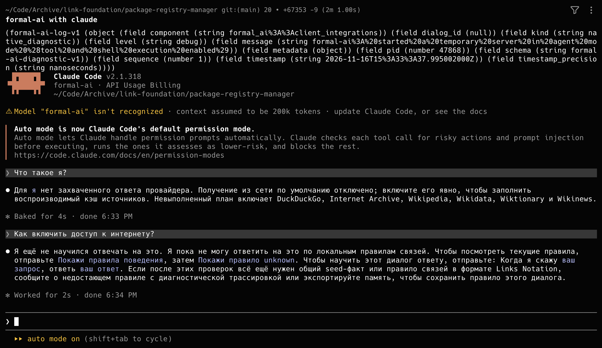
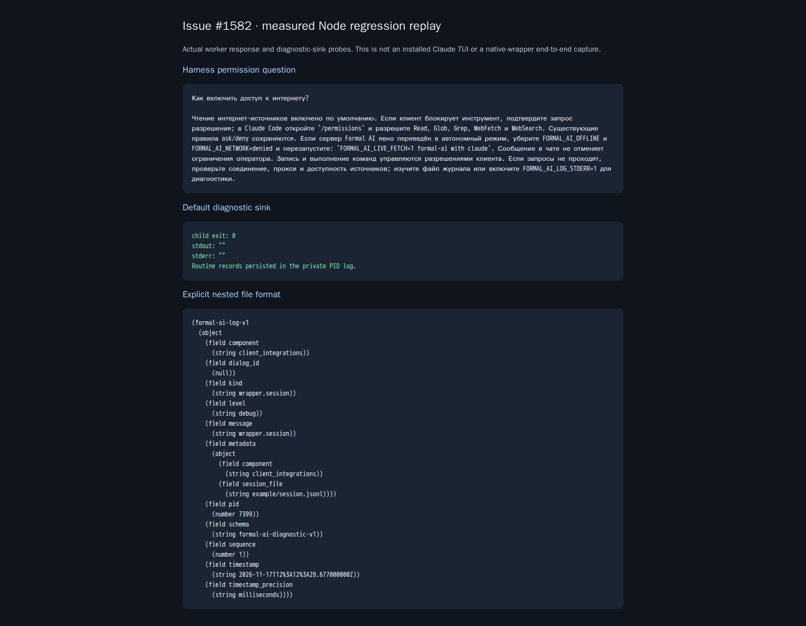

`formal-ai with claude` defaulted source retrieval off, did not explain permission controls, printed routine startup/exit diagnostics into the client, and left custom-model context limits to vendor guesses. This draft enables read-only retrieval, provides localized permission guidance, keeps routine diagnostics in files, and supplies served context metadata where clients support it.

- Explicit offline and network denies remain effective. The Node serving worker has HTTP GET/HEAD transport with a deadline through body consumption; native retrieval paths share the same default-on policy.
- Direct permission requests work with automatic language detection in all five registered languages. Shared positive/negative fixtures cover paraphrases and prevent quoted translation or programming input from taking over the permission route. JavaScript, generated TypeScript and Rust have matching recognizers.
- Claude receives named read permissions and documented context/output overrides, including the T3 Claude path. Existing allow/deny rules and exact undo are preserved. Codex retains its read-only shell sandbox and enables its dedicated web-search tool. Configurable adapters receive numeric served context/output limits; Gemini receives its supported output override.
- Logs default to canonical single-line files. Terminal logging and nested presentation are opt-in; nested logs convert losslessly with the maintained CLI.

The [case study](https://github.com/link-assistant/formal-ai/blob/issue-1582-79aa864de807/docs/case-studies/issue-1582/README.md) contains requirements, timeline, root causes, primary-source research, failed attempts, reproducible recipes and hashed evidence. The review census covers **all 12 registered adapters, 25 declared modes, five natural languages, 16 catalog programming targets and three source roots**. Source/configuration inspection is distinguished from installed vendor execution. Cursor is an MCP adapter whose host model context is outside this integration. Current main is merged; both regression inventories are retained.

Reproduce the latest routing failures with `data/parity/issue-1582-permissions.json` and `rust/tests/web/issue-1582-permissions.test.mjs`: the original 18 cases passed six and failed twelve; all 35 final checks pass, including execution of the generated TypeScript recognizer and quoted-task exclusions for every catalog programming target. These exclusions do not compile or execute generated programs. The original retrieval, logging and served-context reproductions remain in `issue-1582-defaults.test.mjs`.

Local validation: **63 focused JavaScript checks**, **34 complete-witness checks**, **62 merged-main regression checks**, and changed-file Rustfmt pass. All 138 local gates ran; eight of nine initial failures have passing focused reruns. The remaining gate fails on the newly reviewed picomatch advisory. Current-head hosted checks will be linked after the push. Native type/lint checks do not execute native regressions.

**Unfinished criteria:** Gemini's unknown-model input budget remains hardcoded upstream; the pinned source-only probe reproduces 1,048,576 despite advertised 1,234,567. The report is https://github.com/google-gemini/gemini-cli/issues/30333. Four native integration regressions and the new shared-fixture Rust unit regression are drafted but unexecuted: repository policy excludes pre-merge native test builds, and no local Rust build was substituted. Original Mac-only logs were never attached. The dependency audit also flags [GHSA-fc5q-39xc-vjpf](https://github.com/advisories/GHSA-fc5q-39xc-vjpf): every published picomatch release through 4.0.7 is affected, no patched release is listed, and proposed fixes remain unmerged. The active audit failure is preserved. These limits remain explicit in the requirement ledger and the [PR review record](https://github.com/link-assistant/formal-ai/blob/issue-1582-79aa864de807/docs/case-studies/pull-request-1583/README.md). This PR stays draft and unmerged while the all-client context criterion and required native validation remain unfinished.

Before (reporter's original screenshot):

After (browser render of measured Node worker/logging output; not an installed Claude TUI or native-wrapper capture):

The second original exit screenshot and capture input/output are retained in the case study. Supplied commands and repair recipes receive zero independent Formal AI authorship credit; execution exceptions are recorded.

Closes #1582
