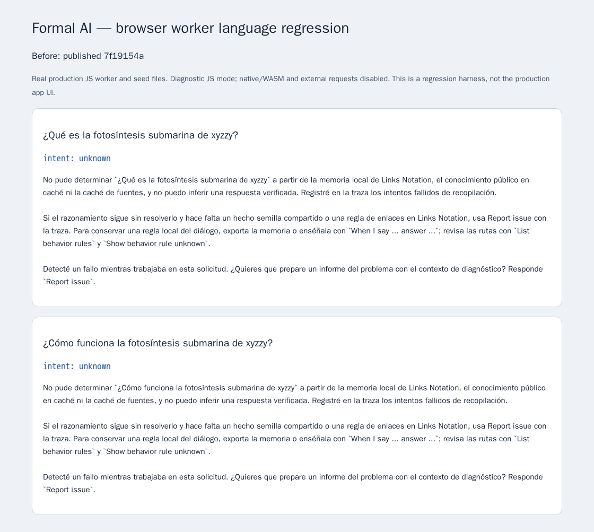
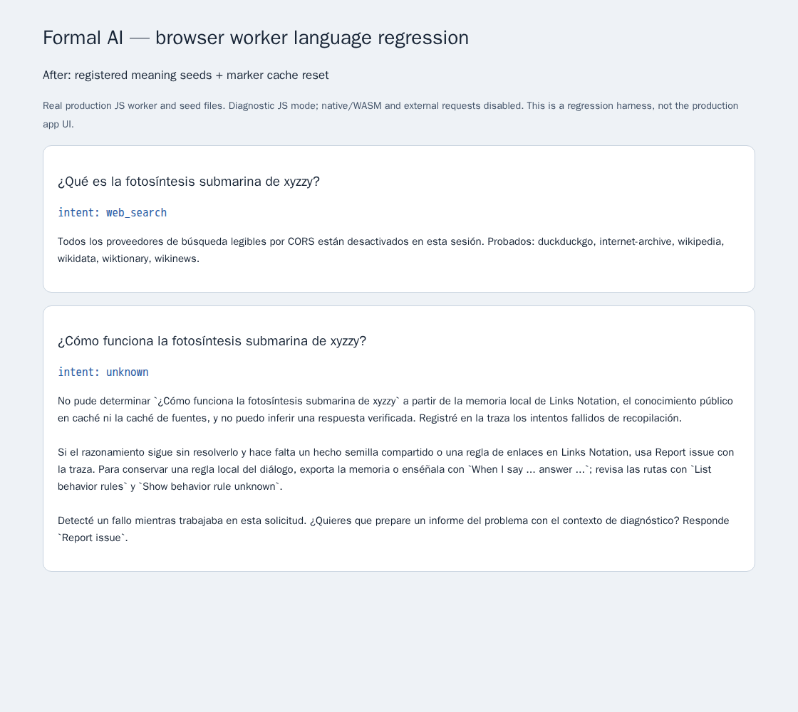

CI omitted native inputs, lost task/source ownership and accepted incomplete process or Git evidence. This draft repairs those boundaries and adds focused native replays. Issue #1580 remains unfinished; keep this PR draft and unmerged.

Fixes #1580

Changes:

- Preserve quoted task passages, request-local constraints, selected-child provenance and unresolved status for unverified drafts. Reuse source-bound calculation and counting evidence; regenerate maintained language projections through their official writers.
- Preserve multilingual lookup, explanation, calendar and controlled-language grammar behavior. Accept canonical IPv4 web operands while excluding attachment metadata.
- Admit complete native reasoning, interface, Hive, workflow, benchmark and fixture source closures. Separate expensive native families with two concurrent matrix runners, preserving all 14 targets, single test threads, failure propagation and existing 20-minute clocks. Keep the complete runner available.
- Keep routine wrapper diagnostics in files unless verbosity is explicit. Forward client flags independently and retain the empty-stderr contract.
- Open closed-program sequence search using bounded atoms from actual ranked fragment types. Preserve IR content IDs and rejection stages; an empty frontier creates no attempt. Verification requirements remain intact.
- Decode appended HTTP capture records individually using their public schemas, preserving capture/privacy/ephemeral-memory assertions. Replay Hive workflow delivery in real temporary Git repositories with explicit compiler/CI fixtures; missing Git evidence or failed verification prevents commit.
- Enforce budgets until the process group finishes, including children whose parent exited. Account for Bash's coarse elapsed clock at the deadline boundary. Preserve command statuses, stdout, stderr and warning-only behavior; report unavailable process inspection.
- Reject failed/partial Git lockfile inventories before Cargo audits. Check package versions on release-prefixed PR branches instead of trusting branch names.
- Create manual changelog fragments exclusively, preserving existing files on collisions and refusing symlinks. Adopt the Rust template shared fallible Actions output writer in all six release callers; configured output failures now stop before success reporting. Add both helpers and all callers to native admission.
- Parse actual Cargo package identity and workspace configuration in release helpers. Replace only the package-version token, preserving comments, CRLF and unrelated manifest bytes; refuse missing or inherited versions before writes. Include the separate changelog collector and preserve name-only badge lookup.
- Retry a failed native checkout once within the existing four-minute checkout allowance and twenty-minute job clock; preserve sparse checkout, ref selection and credential settings. Require one actual success before compilation.
- Retain pinned template comparisons, executable negative controls and upstream reports. Reporting a defect establishes no upstream repair.

Verification:

- Previous published head `11c0bd05` completed all 23 workflows: 21 succeeded. The [Pipeline](https://github.com/link-assistant/formal-ai/actions/runs/44673787597) confirms 60 workflow contracts, reasoning 141/141, interfaces 78/78, benchmarks 11/11 and all 37 Hive cases, including restored full Claude Kotlin and Codex delivery. Core proves four fragment-ownership and seven fallible-output cases. These are actual hosted tests, separate from the unchanged-original acceptance ledger.
- Two failures are preserved in the [exact-head CI assessment](https://github.com/link-assistant/formal-ai/blob/issue-1580-8d61a32a61e1/experiments/issue-1580/evidence/ci/native-families-11c0bd05/assessment.json): Layered CI assumed fresh redirected checksum output always preceded directory enumeration (raw job lines 5162–5176); coding checkout aborted on a lazy blob transfer (`curl 28`, raw lines 140–142), before any compiler ran. Correct the ordering assumption with eight fresh/pre-existing-output fixtures and add the bounded checkout retry. Hosted execution of this new repair batch remains pending.
- Package identity has nine physical-manifest regressions, existing workspace cases, an actual manual-bump consumer regression and a collector regression covering earlier dependency versions plus missing/inherited package versions. Source admission passes 32 focused and 92 maintained checks; Rust formatting, 10 applicable JavaScript gates and deployed release-source verification pass. The checkout guard executes six outcome pairs per job. Before-controls fail as expected. [Local receipts](https://github.com/link-assistant/formal-ai/tree/issue-1580-8d61a32a61e1/experiments/issue-1580/evidence/checks/changelog-package-reader) distinguish these checks from pending hosted native behavior; no local Rust build ran.
- Timer regressions reproduce failures before repair: two coarse-clock cases and six parent-exit/child-lifetime cases. All focused cases pass after repair, alongside maintained release/cache/template, container and native-artifact controls. Fixtures bound memory and lifetime and reap their children. ShellCheck passes; no local Rust build or native execution runs.
- Four release-prefix controls fail before repair and pass after it; the maintained policy entrypoint passes 86 checks. Legitimate manual release fragments still pass, and immutable current-base comparison remains required.
- Java's pinned project-version CLI reports success without changing the version in three parent/comment cases. Rust's pinned desktop checksum command includes stale fragments and can include its own output on GNU and shasum paths. Fresh-output self-inclusion races enumeration; pre-existing-output self-inclusion is deterministic. Local reproductions and corrected candidates are retained; 57 maintained template checks and 43 unchanged upstream prerequisite checks pass. Reports include [Java #32](https://github.com/link-foundation/java-ai-driven-development-pipeline-template/issues/32), [Rust #213](https://github.com/link-foundation/rust-ai-driven-development-pipeline-template/issues/213) and [Rust #251](https://github.com/link-foundation/rust-ai-driven-development-pipeline-template/issues/251). Upstream repair and hosted publication remain unverified.
- Selected production review covers 106 selected diffs, with identities reverified; complete PR review remains unfinished. Java's pinned 207-file applicability map is complete, while applicable implementation/runtime acceptance remains open. Rust literal source review covers 122/373 files and 20,175 lines; 251 files and practice verification remain open.

Focused reproduction:

```sh
timeout 600 node --test --test-concurrency=1 rust/tests/web/hive-work-item-consumer.test.mjs
timeout 600 node --test --test-concurrency=1 rust/tests/web/fast-pull-request-production-profile.test.mjs
timeout 600 node --test --test-concurrency=1 experiments/issue-1580/native-regression-groups.test.mjs
timeout 600 node --test --test-concurrency=1 experiments/issue-1580/native-checkout-retry.test.mjs
timeout 600 node --test --test-concurrency=1 experiments/issue-1580/budget-clock-boundary.test.mjs
timeout 600 node --test --test-concurrency=1 experiments/issue-1580/deadline-process-lifetime.test.mjs
timeout 600 node --test --test-concurrency=1 rust/tests/web/default-branch-build-policy.test.mjs
timeout 600 node --test --test-concurrency=1 experiments/issue-1580/template-java-project-version.test.mjs
timeout 600 node --test --test-concurrency=1 experiments/issue-1580/template-rust-desktop-checksums.test.mjs
node experiments/formal_ai_subagent/local-gates.mjs
```

Earlier browser source-binding evidence uses a labeled production-worker harness with external requests blocked:





Unfinished acceptance is tracked in the [work plan](https://github.com/link-assistant/formal-ai/blob/issue-1580-8d61a32a61e1/experiments/issue-1580/work-plan.md) and [case study](https://github.com/link-assistant/formal-ai/blob/issue-1580-8d61a32a61e1/docs/case-studies/issue-1580/README.md): current-head CI, remaining original native and budget contracts, all eight complete template comparisons and applicable practices, dependency migrations and warnings, historical cache/Docker evidence, live delivery/model identity, general binding/provenance and complete PR review. Strict dated original-source passing evidence is 31/53; matching names from changed fixtures alone earn no original-source acceptance. Independently accepted Formal AI reasoning remains 0/20; supplied commands, patches and reviews earn no independent credit.
