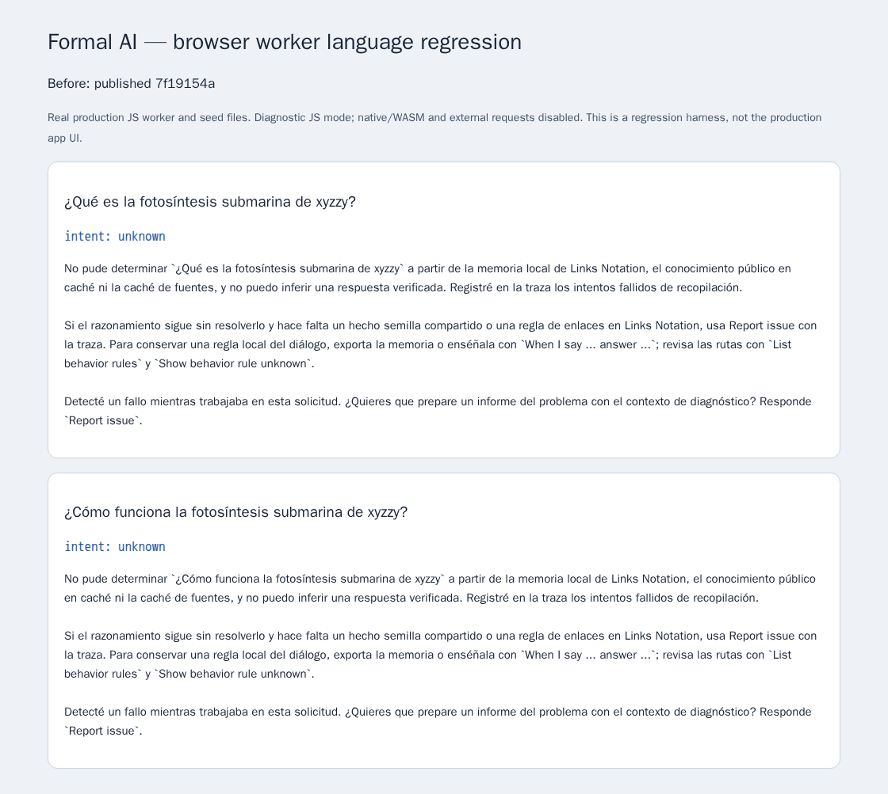
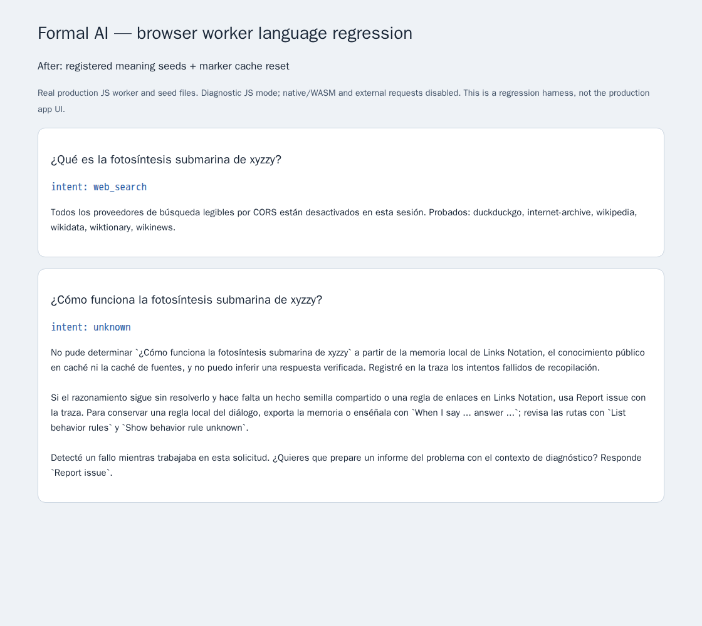

CI omitted native inputs, lost task/source ownership and accepted incomplete process, Git or compressed-secret evidence. This draft repairs those boundaries and adds focused native replays. Issue #1580 remains unfinished; keep this PR draft and unmerged.

Fixes #1580

Changes:

- Reject failed maintenance lock enumeration before any resolver; enforce one shared retry/request budget. Add a default-off Rust macro-context observation using the original read-only security database and bundled pack.
- Pin every BuildKit setup to a registry-verified multi-platform digest. Retry the actual official setup action through the mirror; preserve explicit image overrides and cleanup behavior. Add a read-only real-daemon, image-identity and deliberate canonical-outage probe.
- Split three oversized Rust scripts into unchanged test/CLI companion modules, preserving exact formatter-normalized reconstruction. Add their exact original standalone sources as three focused native test targets, including all 22 requirement-assembler and 17 ordered-list cases and the self-hosting ledger suites. Refresh the secret-inventory profile to require waiting for complete Git producer output.

- Preserve quoted task passages, request-local constraints, selected-child provenance and unresolved status for unverified drafts. Reuse source-bound calculation and counting evidence; regenerate maintained language projections through their official writers.
- Preserve multilingual lookup, explanation, calendar and controlled-language grammar behavior. Accept canonical IPv4 web operands while excluding attachment metadata.
- Admit complete native reasoning, interface, Hive, workflow, benchmark and fixture source closures. Separate expensive native families with two concurrent matrix runners. Divide the live reasoning listing into two measured exact shards and retain all three Hive shards, all 14 original targets, single test threads, failure propagation and existing 20-minute clocks. Keep the complete runner available.
- Keep routine wrapper diagnostics in files unless verbosity is explicit. Forward client flags independently and retain the empty-stderr contract.
- Open closed-program sequence search using bounded atoms from actual ranked fragment types. Preserve IR content IDs and rejection stages; an empty frontier creates no attempt. Verification requirements remain intact.
- Decode appended HTTP capture records individually using their public schemas, preserving capture/privacy/ephemeral-memory assertions. Replay Hive workflow delivery in real temporary Git repositories with explicit compiler/CI fixtures; missing Git evidence or failed verification prevents commit.
- Enforce budgets until the process group finishes, including children whose parent exited. Account for Bash's coarse elapsed clock at the deadline boundary. Preserve command statuses, stdout, stderr and warning-only behavior; report unavailable process inspection.
- Reject failed/partial Git lockfile inventories before Cargo audits. Check package versions on release-prefixed PR branches instead of trusting branch names.
- Create manual changelog fragments exclusively, preserving existing files on collisions and refusing symlinks. Adopt the Rust template shared fallible Actions output writer in all six release callers; configured output failures now stop before success reporting. Add both helpers and all callers to native admission.
- Parse actual Cargo package identity and workspace configuration in release helpers. Replace only the package-version token, preserving comments, CRLF and unrelated manifest bytes; refuse missing or inherited versions before writes. Include the separate changelog collector and preserve name-only badge lookup.
- Retry a failed native checkout once within the existing four-minute checkout allowance and twenty-minute job clock; preserve sparse checkout, ref selection and credential settings. Require one actual success before compilation.
- Refuse uncertain crates.io, GitHub release and Docker tag observations before release decisions or version mutations. Bound retryable failures, stop on permanent errors and validate returned identities. Add a separate read-only native job for the actual helper and both release CLIs against local HTTP fixtures.
- Propagate fragment directory, read and cleanup errors in bump selection, standalone changelog collection and version preparation. Use the exact consumed snapshot for cleanup; retain canonical formatting and newly arrived fragments. Admit actual filesystem regression functions to focused native CI.
- Refresh JavaScript weights from complete measured events without lowering conservative historical costs; split the complete fast PR inventory into four groups with the same deadlines and eight main groups.
- Bind initial Hive and Formal AI sources to verified literal-main checkouts before executing draft source, then reuse the sealed SHAs. Give standalone Rust scripts their separate declared Cargo contexts and the direct-rustc worker its actual WASM context; match CodeQL 2.27.4's measured Rust 1.99.0 proc-macro ABI. Preserve compiler, metadata and build provenance; preparation errors stop analysis.
- Reject malformed or missing CodeQL reports, unresolved findings and unsuccessful/extraction-diagnostic invocations. Preserve the exact producer reports; stop when Rust sysroot prerequisites are incomplete. Retain both native CodeQL assertions in full and focused suites, including their complete admission inputs.
- Correct the native release fixture to include every status surface staged by the actual writer. Preserve real Git staging and the CLI assertions. Allow an explicit manual read-only CodeQL producer run on a branch, sharing the main producer steps and preserving their original reports.
- Select only active Cargo optional dependencies when constructing Rust analysis contexts; preserve required build-script and proc-macro validation. Admit the detector’s real Git regressions to native CI.
- Replace deprecated Node ZIP extraction in shared native-binary and selected-source renderer downloads with strict-digest raw transport and validated streaming Python extraction. Preserve artifact names, destinations, cached replacement and permission restoration. Add actual Linux/macOS/Windows transport qualification.
- Migrate all 97 direct artifact consumers across 19 workflows to the strict-digest raw transport and streaming extractor, preserving names, destinations, selection semantics, Python compatibility and staged release operations.
- Replace the deprecated Pages bundle with the template REST retry/poll/cancel protocol. Bind retry adoption to repository, immutable upload artifact ID and full source SHA; preserve workflow trust, permissions, concurrency, deadlines and live verification. The actual pinned JavaScript/Python helpers reproduce cross-artifact adoption before this repair.
- Upgrade published web-capture to 0.5.3, removing fxhash from the actual lockfile and deleting only its obsolete audit exception. Admit all seven existing component-boundary native tests and their runtime fixture closure. Strict Chrono proof and --deny warnings remain.
- Retain pinned template comparisons, executable negative controls and upstream reports. Reporting a defect establishes no upstream repair.

- Build Pages after validated release checks even if package publication fails. Preserve publisher completion dependencies, cancellation and trusted-main admission; choose the immutable triggering SHA for fallback and the verified release child SHA for successful publication. Regenerate the maintained staged-release projection.
- Validate workflow/job `concurrency.queue` literals and the forbidden `max`/cancellation combination alongside actionlint's narrow upstream schema exception. Use the existing locked YAML parser; retain the actual Docker linter and ShellCheck canary. Official actionlint 1.7.12 demonstrably accepts three invalid fixtures before this companion gate.
- Resolve the optional macro query memory against its actual dataset before execution. Retain the 4 GiB total allowance with zero off-heap allocation, require a resolved 2–4 GiB heap and fail visibly on retained runtime diagnostics. Preserve original SARIF gates, two threads, disk-cache limit and command budgets. The previous launcher override did not survive child evaluator sizing.
- Refresh Hive weights from all 37 completed hosted cases, preserving prior maximum costs. Isolate the previously unmeasured eleven-minute workflow case; retain all tests, unchanged deadlines, and the exact three observed inputs in sparse checkout.

- Retry actual pinned raw artifact transport at most three times after an observed Windows matching-name lookup failure. Reset partial output before retrying; preserve strict digests, selectors, cancellation, validated extraction and terminal failure propagation. Complete the sparse-checkout expectation for its three consumed timing inputs.

- Reduce source-size warnings through twenty-one helper extractions with exact inverse controls and preserved public paths. The two latest groups isolate protocol message types and localized seed response readers, preserving serialization, lookup, fallback and template behavior. Retain exact inverse proofs, initial formatting failures and the original size limits; partition the retained gate summary with byte-exact reconstruction.

Verification:

- The latest fully collected head `d48b09883ac91cd1d2319bea2afbaf0df2df8f86` has 27 terminal workflows: 23 success, one skip and three failures. All 200 original/compressed command streams verify. [Pipeline 44843761970](https://github.com/link-assistant/formal-ai/actions/runs/44843761970) exposes seven missing seed-parent imports and one stale protocol-parent import (full-log lines 42913 and 42990); commit db4f64b41 corrects those bindings. Nine native jobs are compile-blocked; the registry job separately passes 48 Rust and eight actual CLI cases. New hosted compilation remains pending. [Layered CI 44843761720](https://github.com/link-assistant/formal-ai/actions/runs/44843761720) exposes the stale producer fingerprint at line 8379; commit 5792163c5 retains the failing-before/passing-after maintained case and exact producer inverse.
- [Security 44843748460](https://github.com/link-assistant/formal-ai/actions/runs/44843748460) fails the new included-string observation at line 4819: the query compiles in 25.1 seconds but evaluation exceeds the unchanged four-minute deadline. No final table/manifest is produced. Narrow helper domains and opt-in evaluator tracing are a performance hypothesis pending hosted verification; the exact expensive relation and result equivalence remain unproven. Both original standard SARIF reports remain clean. The completed macro profile has 122,555 contexts across 2,229 files, a 2,607 MiB heap and no runtime diagnostics; 136 original payloads verify. All 631 unexpanded positions still require semantic qualification. The local query adapter, strict security and retained producer suites pass; payload/CFG presence alone will not establish coverage.
- The complete maintained template adapter passes 93 cases, including 15 new PHP original/candidate input-integrity cases and all seven lifetime cases. Nine selected version/base-admission cases, Rust formatting and projection currency pass. The complete 141-entry gate replay catches new receipt filename abbreviations; the payload-preserving repairs leave the ratchet unchanged. The full replay is 140/141 passed or skipped, with only the 93-versus-90 filename check failing; after three payload-preserving source receipt renames the focused check passes at 90/718/908. Both outcomes remain separate in the batch seal. No local Rust compilation or execution occurs.
- Twenty-one source extraction groups leave 97 size warnings and zero ordinary/embedded-data violations under unchanged limits. Published annotations retain those 97 source warnings and publish-token uncertainty; unsafe-libyaml maintenance remains open. The Workflows canonical-registry outage is a deliberate negative control with actual mirror recovery. All aggregate lines have not been literally reviewed; no all-warnings-resolved claim is made. [Source checkpoint](https://github.com/link-assistant/formal-ai/blob/issue-1580-8d61a32a61e1/docs/case-studies/issue-1580/source-warning-extraction-checkpoint.md).
- PHP source review adds 98 fully read files and partial composer.lock ranges to 17 previous files, with 22 pinned bounded pages retained. Seven bounded pinned PHP process-group cases leave live workers; all seven Formal AI counterparts pass. Version observation admits missing/invalid evidence, and release-note truncation emits invalid UTF-8 at its default cap. The 15 maintained tests preserve original failures, disposable candidates and positive controls. Fresh upstream b61e3347 has identical relevant source blobs. No upstream repair or full template/runtime qualification is claimed. The existing package-identity and checksum scoped practice evidence remains separate from complete template acceptance.
- The Pages regression has five expected failures on previous sources and passes all 13 controls after repair. Actual temporary Git repositories verify trigger/child checkout identity; 64 admission, five trust, three activation, five authority, 15 native-operation and 18 profile checks pass. Actual hosted fallback publication and Pages served identity remain unverified. [Pages checkpoint](https://github.com/link-assistant/formal-ai/blob/issue-1580-8d61a32a61e1/docs/case-studies/issue-1580/pages-release-failure-checkpoint.md).
- Official actionlint 1.7.12 plus the repository exception accepts three invalid queue fixtures before repair; the companion gate rejects them. All 13 focused controls pass, and the actual hosted Workflows job executes 60-workflow/19-policy validation successfully. [Queue checkpoint](https://github.com/link-assistant/formal-ai/blob/issue-1580-8d61a32a61e1/docs/case-studies/issue-1580/workflow-queue-checkpoint.md).
- Failing-before controls cover artifact lookup retries, child evaluator sizing, incomplete sparse checkout, compressed credentials/corrupt gzip, partial Git inventories, parent-exit child budgets, deadline boundaries, release-prefix admission, manifest identity, fragment I/O, shared output failures and uncertain registry responses. Initial failed probes and harnesses remain retained.
- Rust template literal review covers 352/373 pinned identities and 49,166 lines, with exact full-content reconstruction for reviewed historical dependency/release snapshots. Current lock/manifest consumers remain distinct from historical inventories; applicable-practice/runtime adoption and all eight complete comparisons remain unfinished. A dated selected production review covers 154 paths; the later eight-path repair diff has a separate complete 752-line review; review of the complete PR remains open.

Upstream reproductions and reports:

- PHP input and ownership reproductions: [version guard #31](https://github.com/link-foundation/php-ai-driven-development-pipeline-template/issues/31), [UTF-8 release notes #32](https://github.com/link-foundation/php-ai-driven-development-pipeline-template/issues/32), and [additional bounded evidence on existing issue #15](https://github.com/link-foundation/php-ai-driven-development-pipeline-template/issues/15#issuecomment-7054888090). Fifteen actual PHP original/candidate input tests and seven process-group controls retain their limits and positive controls. Reporting does not establish upstream repair.
- Actual pinned Pages helpers reproduce cross-artifact adoption: [JavaScript #310](https://github.com/link-foundation/js-ai-driven-development-pipeline-template/issues/310), [Python #163](https://github.com/link-foundation/python-ai-driven-development-pipeline-template/issues/163).
- Pinned project-version and checksum reproductions, with actual original/candidate observations: [Java #32](https://github.com/link-foundation/java-ai-driven-development-pipeline-template/issues/32), [Rust #213](https://github.com/link-foundation/rust-ai-driven-development-pipeline-template/issues/213), [Rust #251](https://github.com/link-foundation/rust-ai-driven-development-pipeline-template/issues/251). The source-confirmed fragment overwrite/symlink issue is [Rust #254](https://github.com/link-foundation/rust-ai-driven-development-pipeline-template/issues/254); its template CLI execution remains unverified.
- Published web-capture 0.5.3 removes fxhash from the actual lockfile and its obsolete exception. Mandatory published Chrono consumers and experimental unsafe-libyaml maintenance remain open. Reporting an upstream issue establishes no upstream repair.

Focused reproduction (run each test separately):

```sh
node --test --test-concurrency=1 experiments/issue-1580/template-php-input-integrity.test.mjs
timeout 600 node --test --test-concurrency=1 rust/tests/web/native-test-artifact.test.mjs
timeout 600 node --test --test-concurrency=1 experiments/issue-1580/pages-release-failure.test.mjs
timeout 600 node --test --test-concurrency=1 experiments/issue-1580/workflow-concurrency.test.mjs
timeout 600 node --test --test-concurrency=1 experiments/issue-1580/native-regression-groups.test.mjs
timeout 600 node --test --test-concurrency=1 rust/tests/web/security-codeql-results.test.mjs
node scripts/check-workflow-concurrency.mjs
node scripts/generate-staged-release.mjs --check-deployed
node experiments/formal_ai_subagent/local-gates.mjs
```

The hosted-only registry job runs `cargo test --manifest-path experiments/issue-1580/release-registry/Cargo.toml --locked --lib --test assemble_requirements --test normalize_ordered_lists --test self_hosting_metric -- --test-threads=1 --nocapture` and `python3 experiments/issue-1580/release-registry/cli_regressions.py`.

Earlier browser source-binding evidence uses a labeled production-worker harness with external requests blocked:





Unfinished acceptance is tracked in the [work plan](https://github.com/link-assistant/formal-ai/blob/issue-1580-8d61a32a61e1/experiments/issue-1580/work-plan.md) and [case study](https://github.com/link-assistant/formal-ai/blob/issue-1580-8d61a32a61e1/docs/case-studies/issue-1580/README.md): next-head hosted native checks for the new helper extractions; actual Pages server acceptance/publication and served identity; per-child Rust semantic extraction coverage; remaining original native and budget contracts; all eight full template comparisons and applicable practices; dependency migrations and warnings; historical cache/Docker evidence; live delivery/model identity; general binding/provenance; and complete PR review. Strict dated whole-file original-source acceptance remains 31/53; the other 22 changed-file assertion contracts have separate scoped compatibility reviews, with original budget and live criteria still open. Independently accepted Formal AI reasoning remains 0/20; supplied commands, patches and reviews earn no independent credit.
