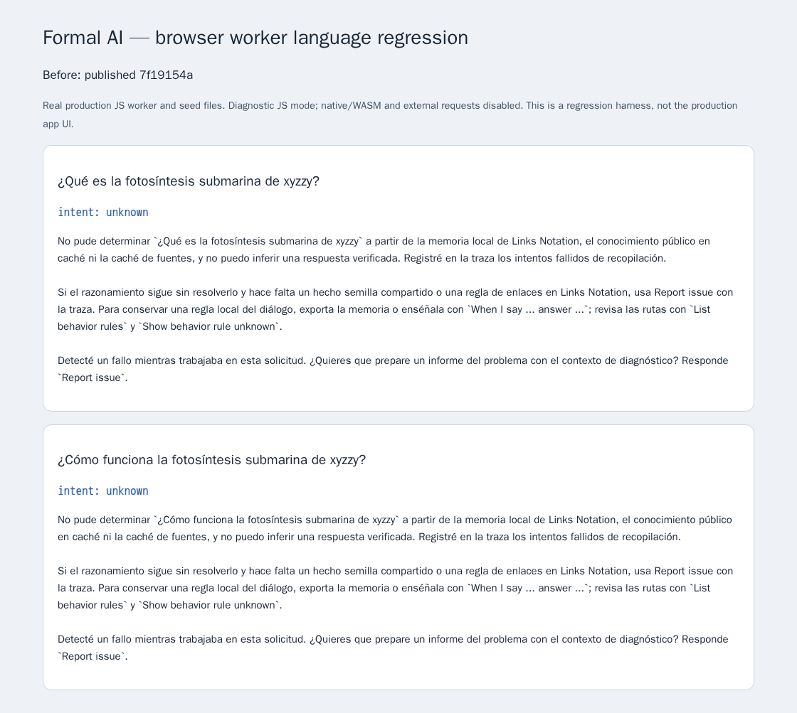
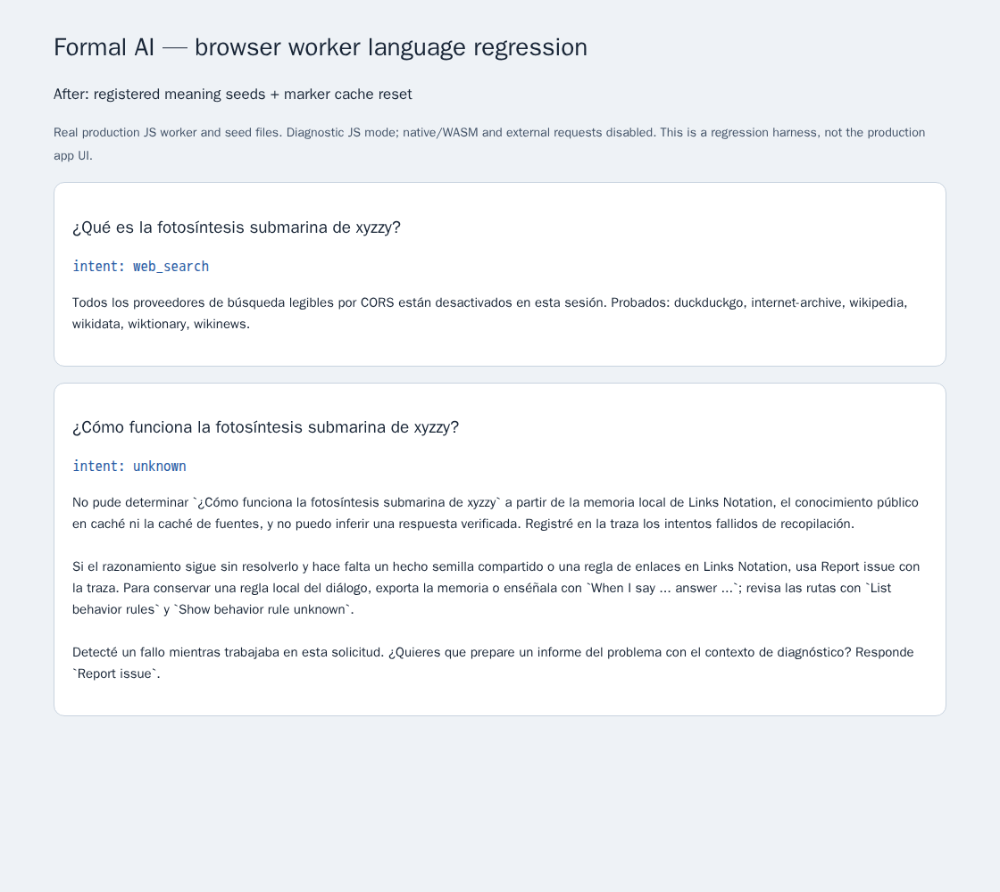

CI missed native regression inputs and source ownership failures, while compound task parsing lost quoted passages and accepted unverified child drafts. This draft repairs those boundaries, source-derived algebra/counting behavior, request-local constraints and recorded CI fixtures. It also retains executable CI/CD template comparisons and upstream defect reports. The complete issue remains unfinished; keep this PR draft and unmerged.

Fixes #1580

Changes:

- Preserve ASCII and CJK quoted passages and seeded passage cues during JavaScript/Rust decomposition. Keep genuine surrounding tasks, escapes and apostrophes; retain all original shared cases and add bounded controls across five languages.
- Keep nonempty unverified drafts unresolved, including cached children and all-required parents. Retain only selected-child evidence through composition, caching and answer adoption; exclude unused alternatives.
- Reuse calculation parsers for bound algebra questions. Replay source operands for renumbered remainder-sale problems and derive object counts from membership evidence. Preserve existing answer, trace and negative controls.
- Correct decoded native structural values and calendar alias ownership without losing scalar spellings or order. Preserve request-local output constraints, path-bound OpenCode reads, declared response languages, counting proofs and explicit fixture network policy.
- Encode controlled-language alternatives as canonical reference sequences and keyed forms, preserving every decoded grammar field and empty positional alternative. Correct embedded JSON quoting, regenerate official projections and refresh demanded package mirrors without weakening the unchanged native data contracts.
- Admit isolated native regression sources and embedded fixtures even when production files do not change. Run the existing synthesis contracts, executor parity, calendar/currency and forced-function targets in hosted CI. Align one dormant synthesis expectation with the already documented whole-sentence summary contract; keep exact equality. The focused operational target executes the maintained shell documentation contracts and unchanged network-download contracts.
- Hydrate meaning seeds through the generated filename registry and reset warmed search markers on replacement. Replay both original Spanish siblings and preserve the entire unresolved answer. Bind native retrieved definitions to the requested term before source ranking, refuse gloss substitution for unsupported-language sentences and operative questions, and bind public-cache answers to the complete requested subject, stripping only authored leading cache instructions. Preserve matching definitions and bare-term lookup. Route worker subtasks through the existing shared draft while retaining subtask guards. Calendar creation is registered directly and promoted with the same clause-local evidence as admission, preserving explicit memory writes. Shared numeral spans retain requested spelled hours, minutes and AM/PM across five languages.
- Repair change detection, required-context reporting, source placement/ownership fixtures and bounded cache diagnostics. Reduce JavaScript checkout inputs while preserving consumed archives and generated workflow operations. Keep current main merged and required native job context present for source-free changes.
- Preserve pinned template files and actual release-path regressions. The PHP release guard can admit unsuccessful quality checks; separately, its release CLI reports success after rejected branch/tag pushes. Candidates are tested in disposable copies; upstream repairs are not claimed. Automatic-release admission is reported in [PHP template #27](https://github.com/link-foundation/php-ai-driven-development-pipeline-template/issues/27); ignored rejected pushes are reported separately in [PHP template #28](https://github.com/link-foundation/php-ai-driven-development-pipeline-template/issues/28).

Latest verification:

- Published `d3adb3ce` passes **all 23 workflows**. The [native job](https://github.com/link-assistant/formal-ai/actions/runs/44549609309/job/135649800212) passes **128 Rust cases and four HTTP tests**, including all 28 reasoning/formalization contracts and four operational contracts. All 72 collected payload hashes are verified. The strict unchanged-original-source union remains **17/53**, leaving **36** original panic contracts plus three budget failures unqualified.
- The actual validation-source repair passes **113 focused JavaScript cases**. The complete local inventory initially records **84 pass / 3 fail / 52 exclusions**; focused repairs resolve every failure without raised ceilings, so all **87 executable gates** have passing results. Seven official TypeScript mirrors are current; all 142 validation payloads are hash verified. Four new native controls plus the 16 existing conversation/debug cases are admitted for the next hosted replay (**48 reasoning / 148 total Rust cases plus four HTTP cases expected**, execution pending). See the [validation-origin checkpoint](https://github.com/link-assistant/formal-ai/blob/issue-1580-8d61a32a61e1/docs/case-studies/issue-1580/validation-origin-and-conversation-checkpoint.md).
- The preceding Layered CI failure from two stale Cargo fixture assertions is resolved in published `d3adb3ce`. The governed writer preserves all 1,185 old complete objects and manifest entries, then adds exactly four unsupported native controls and their source identity: **1,189 total / 221 supported / 968 unsupported**. Unsupported JavaScript-reader cases provide no native execution credit. The original failing logs and complete-object equality proof remain retained.
- Shared numeral spans retain the original five scheduling forms over HTTP, with **51 clock tests** and **192 tests** across the preceding seven focused files. All **87 executable local gates have passing results with 52 explicit exclusions** across that full inventory and focused repairs (raw final inventory: 85 pass / 2 fail / 52 exclusions). These earlier local results remain separate from the later reasoning/download batch and current full governed-fixture validation. See the [calendar clock checkpoint](https://github.com/link-assistant/formal-ai/blob/issue-1580-8d61a32a61e1/docs/case-studies/issue-1580/calendar-clock-and-native-checkout-checkpoint.md).
- Main `53cbe443` is integrated as `5af5dfd7`. Complete decoded output policy and all five grammars remain equal after canonicalizing 986 fields; official generated sources and demanded package mirrors are refreshed. That historical complete-object governed union retained **1,185 / 221 supported / 964 unsupported**; the current counts and unchanged-original-source replay union are reported above. Historical and current-head verification remain distinguished; no native build runs locally.
- The browser language regression fails three focused cases before the seed/cache fix and passes **10/10** afterward, plus nine adjacent checks. Real Chromium replays `[unknown, unknown]` before and `[web_search, unknown]` after; the entire Spanish “how” answer remains equal. The screenshots show a labeled production-worker harness in diagnostic JS mode with external requests blocked. The four original captured-source native tests and unchanged Spanish sibling now pass in hosted CI. See the [language source-binding checkpoint](https://github.com/link-assistant/formal-ai/blob/issue-1580-8d61a32a61e1/docs/case-studies/issue-1580/language-source-binding-checkpoint.md).
- The summary correction passes **14 existing text-transform tests**, **four routing tests**, **six affected gates**, Rust 2024 formatting and whitespace. A twelve-case browser audit confirms the Halley answer exactly and retains four other full-answer differences, including two unverified browser executor results. This audit is not a passing parity claim.
- PHP rejected-publication regression: **9/9 focused cases**, **52/52 maintained template-observation tests**, and **six affected gates** pass. Real local bare remotes cover both release modes, branch/tag rejection, failure propagation and successful publication. The original files remain hash verified; PHP subprocesses use a 32 MiB heap and finite deadlines. See the [PHP push checkpoint](https://github.com/link-assistant/formal-ai/blob/issue-1580-8d61a32a61e1/docs/case-studies/issue-1580/php-push-integrity-checkpoint.md). [Upstream report #28](https://github.com/link-foundation/php-ai-driven-development-pipeline-template/issues/28) is filed after fresh source/duplicate checks and immutable evidence verification; its exact posted body and receipt are retained.
- At the earlier governed-fixture checkpoint, **all 86 executable local gates pass**, with **52 explicit native/context exclusions and zero failures**, under a 256 MiB Node heap cap. Both unchanged fixture-integrity **2/2** and identifier **34/34** files pass. All 93 aggregate, focused and detailed gate payloads are retained and hash verified; complete case objects remain equal. No local Rust build runs.
- Earlier published algebra head `acb9fa51` passes **23/23 workflows**, including actual native algebra, calendar/currency, forced functions and both HTTP modes. Original failure, correction and retry histories remain in the [work plan](https://github.com/link-assistant/formal-ai/blob/issue-1580-8d61a32a61e1/experiments/issue-1580/work-plan.md) and linked checkpoints; they are separate from current-head verification.

Reproduce focused checks separately:

```sh
timeout 600 node --max-old-space-size=256 --test --test-concurrency=1 rust/tests/web/issue-1174-text-transform-parity.test.mjs
timeout 600 node --max-old-space-size=256 --test --test-concurrency=1 rust/tests/web/summary-payload-routing.test.mjs
timeout 600 node --max-old-space-size=256 --test --test-concurrency=1 rust/tests/web/issue-1550-procedure-census.test.mjs
timeout 600 node --max-old-space-size=256 --test --test-concurrency=1 rust/tests/web/worker-unknown-language.test.mjs
timeout 600 node --max-old-space-size=256 --test --test-concurrency=1 rust/tests/web/solver-event-origin.test.mjs
timeout 600 node --max-old-space-size=256 --test --test-concurrency=1 rust/tests/web/server-debug-session.test.mjs
timeout 600 node --max-old-space-size=256 --test --test-concurrency=1 rust/tests/web/default-branch-build-policy.test.mjs
timeout 600 node --max-old-space-size=256 --test --test-concurrency=1 rust/tests/web/worker-candidate-validation.test.mjs
timeout 600 node --max-old-space-size=256 --test --test-concurrency=1 rust/tests/web/calendar-act-paraphrases.test.mjs
timeout 600 node --max-old-space-size=256 --test --test-concurrency=1 rust/tests/web/calendar-clock-preservation.test.mjs
timeout 600 node --max-old-space-size=256 --test --test-concurrency=1 rust/tests/web/rust-specification-generated-programs.test.mjs
timeout 600 node --max-old-space-size=256 --test --test-concurrency=1 rust/tests/web/cnl-output.test.mjs
timeout 600 node --max-old-space-size=256 --test --test-concurrency=1 rust/tests/web/cnl-parity.test.mjs
timeout 600 node --max-old-space-size=256 --test --test-concurrency=1 rust/tests/web/retrieved-concept-grounding.test.mjs
timeout 600 node --max-old-space-size=256 --test --test-concurrency=1 rust/tests/web/focused-test-map.test.mjs
timeout 600 node --max-old-space-size=256 --test --test-concurrency=1 rust/tests/web/generate-role-registry-js.test.mjs
node --max-old-space-size=256 scripts/generate-role-registry.mjs --check
node --max-old-space-size=256 scripts/translate-es.mjs --check
timeout 600 node --max-old-space-size=256 --test --test-concurrency=1 rust/tests/web/rust-specification-fixture-integrity.test.mjs
timeout 600 node --max-old-space-size=256 --test --test-concurrency=1 rust/tests/web/rust-specification-unicode-identifiers.test.mjs
timeout 600 node --max-old-space-size=256 --test --test-concurrency=1 experiments/issue-1580/template-php-push-integrity.test.mjs
timeout 600 node --max-old-space-size=256 --test --test-concurrency=1 rust/tests/web/issue-1580-template-observations.test.mjs
node --max-old-space-size=256 experiments/formal_ai_subagent/local-gates.mjs
```

Browser worker regression evidence (the screenshots show the labeled harness; production app UI is not verified):





Unfinished acceptance remains explicit in the work plan: the original main inventory (53 distinct native panic headers, 17 with qualifying published hosted passing replays and **36 without one**, plus three unverified budget terminations), semantic regressions and benchmark floors, full file comparison/applicability for all eight templates, dependency migrations and warnings, historical cache/Docker and required-context reproduction, live delivery/model identity, and general parent/passage binding and provenance. Complete literal review of retained native payloads is unfinished. Java historical review is **153/254 continuous pages**, with 123 complete files, one partial and 8,766 complete source lines; pages 154–254 and wider semantic review remain open.

Independently accepted Formal AI reasoning remains **0/20** planned substantive units, below the standing 5% reporting target. Supplied commands, patches, scripts, source reading and upstream reports earn zero independent authorship credit. This reporting target adds no release percentage gate; the broader unfinished issue requirements remain open.
