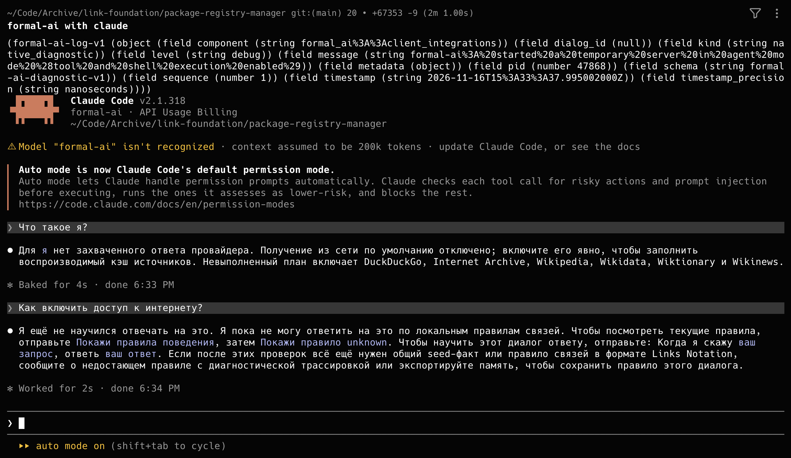
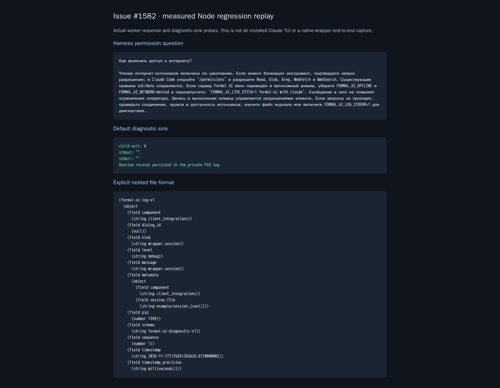

`formal-ai with claude` displayed routine startup/exit diagnostics, defaulted source retrieval off, failed to explain permission controls, and left custom-model context limits to client guesses. This draft enables read-only retrieval, gives permission guidance in all five supported languages, writes routine diagnostics to files, and passes served context metadata to configurable clients.

- Explicit offline/network denies remain effective. The Node serving worker now has a real HTTP GET/HEAD transport. Native dispatcher, capability, version-resolution and benchmark reads share the same default-on policy.
- Claude gets named read permissions and its documented context/output environment overrides; the T3 Claude path receives the same overrides. Global settings preserve existing allow/deny rules and exact undo. Codex enables its dedicated live web-search tool while retaining its existing read-only shell sandbox. Codex, Qwen, Aider and current Grok receive numeric served limits; Gemini receives its supported output override.
- Canonical single-line file logs remain the default. Explicit terminal logging and nested presentation are available; nested logs still convert losslessly with the maintained CLI.
- The [case study](https://github.com/link-assistant/formal-ai/blob/issue-1582-79aa864de807/docs/case-studies/issue-1582/README.md) inventories every requirement, roots, timeline, primary-source research, available issue/PR/workflow data, failed attempts, reproducible experiments and evidence hashes. Original Mac-only logs were not attached and remain unavailable.

Reproduce the original failures with the five permission questions and logger probes in `rust/tests/web/issue-1582-defaults.test.mjs`. Before repair, the original eight probes recorded seven failures; the logging probe was strengthened to measure an actual child process. The final issue suite passes twelve regressions, including real HTTP reads and `/v1/models` resource-derived context metadata.

Validation: **28 focused JavaScript tests pass** across the issue suite and the two existing structured-log suites. Changed handwritten Rust source/tests pass `rustfmt --check`; the generated projection retains its upstream layout (the same formatting-only rejection on base and current) and passes its maintained currency check; native code is left to CI under the container memory limit. The complete local gate inventory passes or explicitly skips all 138 entries with no failures, including round eight after the first hosted CI repairs; the case study retains every correction and skipped-check reason. Four native regressions cover actual Claude/T3 launch environment, remote limits, preserved permissions, exact undo and real chat-CLI loopback fetches with explicit-deny controls; execution of those tests is still required, since the current PR native check compiles/lints production targets only. If broader PR native test coverage is desired, the repository owner can use the [CI/CD guidance](https://github.com/link-assistant/hive-mind/blob/main/docs/CI-CD-BEST-PRACTICES.md).

The first hosted repair head completed 22 workflows: 19 succeeded. All three failures were investigated together: regenerate the permission-role registry, refresh the governed specification witness (complete inventory unchanged; 36 focused witness tests pass), and acknowledge the exact unmaintained chrono advisory through the existing dependency-graph-checked upstream-exception mechanism. Latest introducing dependencies still require chrono; migration reports are https://github.com/link-foundation/command-stream/issues/238 and https://github.com/link-assistant/calculator/issues/265. Every log and the advisory/source evidence are retained. The production native type/lint job passed; the four native regressions remain unexecuted. The second repair head completes all 22 workflows successfully. Final review then adds a transport-wide 30-second deadline that remains active while reading the response body and preserves caller cancellation. Both new regressions fail beforehand; all 12 issue tests pass afterward. The affected source/generated gates are checked again. The final source head still requires hosted CI verification.

**Unfinished acceptance criterion:** Gemini CLI hardcodes an input budget for unknown model names and exposes no supported input-context override. Reported with source-level reproduction, workaround and suggested code change in https://github.com/google-gemini/gemini-cli/issues/30333. This draft remains unmerged and is not ready while the all-clients context criterion or required validation is unresolved. Passing checks alone do not complete it.

Before (reporter's original screenshot):

After (browser render of measured Node worker and logging output; not an installed Claude TUI or native wrapper end-to-end capture):

The second original exit screenshot and capture input/output are in the case study. Supplied patches, commands and recipes earn zero independent Formal AI authorship/reasoning credit; execution-path exceptions and failed attempts are retained.

Closes #1582
